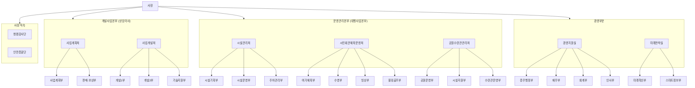

# 과천도시공사 조직도 체계 (Organization Chart)

공식 홈페이지(기구표 및 부서별 연락처 안내) 기준 조직 구조입니다.  
제안 평가 시스템에서 부서 배정 및 평가자 관리에 활용되며, 제안 데이터 구성 시 **"본부/부문" / "처/실" / "부"** 속성으로 세분화하여 기록합니다.

---

## 1. 조직 계층 구조 요약

---

## 2. 세부 조직 목록 ("본부/부문" - "처/실" - "부")

| 본부 / 부문 (Division) | 처 / 실 / 단 (Office) | 부 (Department) | 주요 담당 업무 (참고) |
| :--- | :--- | :--- | :--- |
| **사장 직속** | **청렴감사단** | - | 감사 총괄, 청렴, 인권, 윤리 |
| **사장 직속** | **안전총괄단** | - | 안전 총괄, 시민안전, 재난안전, 산업안전, 보건 |
| **개발사업본부** | **사업계획처** | **사업계획부** | 개발사업 총괄, 예산 및 계약 |
| | | **판매·보상부** | 판매 및 보상 업무 |
| **개발사업본부** | **사업개발처** | **개발1부** | 토목 설계 및 공사감독 |
| | | **개발2부** | 건축 설계 및 공사감독 |
| | | **기술지원부** | 기계, 전기, 소방 설계 및 공사감독 |
| **운영관리본부** | **시설관리처** | **시설기획부** | 시설기획(건축), 시민회관 리모델링, 조경, 임대사업 |
| | | **시설운영부** | 보일러, 가스, 에너지관리, 수질/냉동, 승강기/소방, 전기 |
| | | **주차관리부** | 주차관리 총괄, 종량제봉투, 부설/공영주차장, 교통약자이동지원센터, 관제센터 |
| **운영관리본부** | **시민회관체육운영처**| **여가체육부** | 여가체육 프로그램 운영, 헬스장, 배드민턴, 갈현체육시설 |
| | | **수영부** | 수영 프로그램 운영, 유료사물함 관리, 강습 |
| | | **빙상부** | 빙상장 운영, 정빙/빙질관리, 강습 및 대관 |
| | | **볼링골프부** | 볼링장 및 골프연습장 운영/안전관리 |
| **운영관리본부** | **공원수련관관리처** | **공원운영부** | 체육공원(관문/문원) 운영, 대관, 배드민턴/헬스 강습 |
| | | **시설지원부** | 공원 및 수련관 냉난방, 수질, 전기/소방, 조경, 건축 안전 |
| | | **수련관운영부** | 청소년수련관 운영, 수영/농구/배드민턴/헬스 강습, 셔틀버스 |
| **경영부문** | **경영지원실** | **총무행정부** | 열린혁신, 정보공개청구, GWP, 지역상생, 사회공헌, 차량관리 |
| | | **재무부** | 공사채, 자금관리/운용, 연간계약 관리 |
| | | **회계부** | 재무결산, 원가관리, 지출, 의무구매 실적 |
| | | **인사부** | 노무, 조직, 교육, 인사관리, 급여/수당, 포상, 채용 |
| **경영부문** | **미래전략실** | **미래혁신부** | 도시 정책 연구, 공사 문서보안, 경영평가, ESG경영, 기록물관리 |
| | | **스마트정보부** | 정보화기획, 홈페이지 운영, 개인정보보호, 공공데이터, 업무시스템, 통신 |

---

## 3. 제안 평가 데이터 매핑 규칙

1. **제안 원본 데이터 컬럼 매핑**:
   - `assigned_division`: 본부 또는 부문 (예: `운영관리본부`, `경영부문`, `개발사업본부` 등)
   - `assigned_office`: 처 또는 실 (예: `시설관리처`, `경영지원실`, `미래전략실` 등)
   - `assigned_dept`: 세부 부서명 (예: `스마트정보부`, `시설기획부`, `총무행정부` 등)
2. **0차 평가자 계정 배정**:
   - 기본적으로 평가 단위는 **"부(Department)"** 단위로 부서장이 평가하거나, 처/실 직속 제안의 경우 처/실 단위로 배정 가능하도록 설계합니다.
